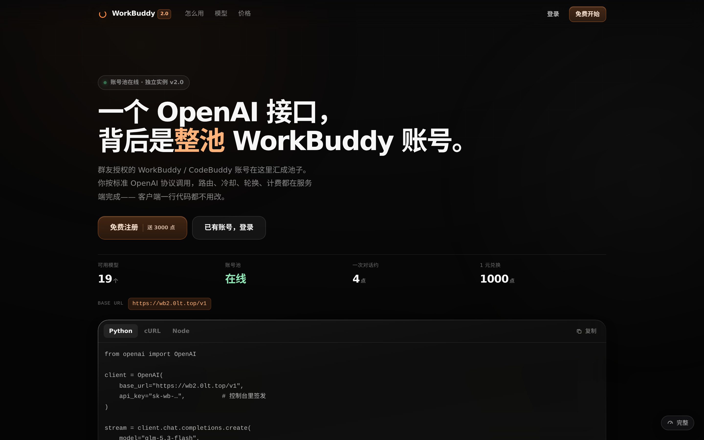

# WorkBuddy 2.0 · 学生 API

把一组 WorkBuddy / CodeBuddy 账号，变成**一个 OpenAI 兼容接口**。

Go 单二进制 + Vue 3 前端 + SQLite，自带注册登录、密钥管理、用量计费、档位/加油包、邀请返利、在线支付、账号池健康与分流。前端产物由 Go 直接托管，一个进程就能起站。

> AGPL-3.0。改了自己开站也必须开源。



---

## 30 秒起站

```bash
git clone https://github.com/lszyk26/wb2api.git && cd wb2api
bash deploy/install.sh          # 自动生成密钥、写 .env、docker compose 起站
```

装完访问 `http://服务器IP:8078`，管理员账号 `admin`，密码在 `.env` 的 `WB2_ADMIN_PASS`（脚本随机生成并打印）。

想手动来：

```bash
cp .env.example .env && vi .env   # 至少填 WB2_PUBLIC_URL、WB2_UPSTREAM、WB2_UPSTREAM_KEY
docker compose up -d --build
```

没有 Docker？见 [docs/DEPLOY.md](docs/DEPLOY.md)（systemd + nginx + 手动编译）。

---

## 它需要什么上游

**本站不生产账号，它只是账号池的门面。** 你必须有一个 OpenAI 兼容的上游网关（默认 `WB2_UPSTREAM=http://127.0.0.1:8788`），本站负责：用户体系、额度、计费、密钥、支付、以及**把请求路由到上游哪个出口**。

上游需要实现的最小契约（`Bearer` 鉴权）：

| 方法 | 路径 | 用途 |
|---|---|---|
| GET | `/v1/models` | 模型清单，支持 `?realm=cn` |
| POST | `/v1/chat/completions` | 对话，支持 SSE 透传 |
| POST | `/accounts/test` | 账号自检（`{uid, model}`） |
| POST | `/accounts/set` | 绑定出口（`{uid, proxySlot}`） |
| POST | `/accounts/delete` | 移出账号池 |
| POST | `/accounts/login/start` `…/poll` | OAuth 一键授权 |

完整字段与返回值见 [docs/UPSTREAM.md](docs/UPSTREAM.md)。上游账号目录（`WB2_HUB_DIR/accounts/*.json`）与用量文件（`WB2_USAGE_PATH`）也会被本站读写，用于账号提交与真实用量对账。

---

## 功能

- **用户侧**：注册 / 邮箱验证码登录 / GitHub OAuth 一键登录、找回密码、邀请码返利、抽奖、站内演练场
- **密钥**：`sk-wb-` 开头，按档位限数量，库里只存哈希 + 加密副本，支持轮换
- **OpenAI 兼容**：`/v1/chat/completions`（流式 / 非流式）、`/v1/models`、`/v1/messages`（Anthropic 风格）
- **计费**：点数 = (输入×2 + 输出×8)/1000 × 模型倍率，日额度按天重置，超额自动吃加油包
- **档位**：赞助档（LV1~LV3）与贡献档（C1~C4，按授权账号数现算）取较高日额度，C1~C3 可叠 1.5 倍、封顶 30 万点/日
- **账号池**：OAuth 授权 → 自检 → 入池 → 轮转绑出口；会话级 cn/intl 分流，单侧失败自动换边重试
- **支付**：彩虹易支付（epay）/ 木瓦（mupa）双驱动，异步回调验签
- **管理台**：用户、订单、卡密、账号审核、档位改价、抽奖奖池、上游健康、结算
- **前端**：iOS 暗玻璃风格、50+ 动效、四档流畅度切换、移动端抽屉；断网/失败/空态三态分明

---

## 配置

所有配置走 `.env`（或 `WB2_ENV_FILE` 指向的文件），改完重启即可。常用项：

| 变量 | 默认 | 说明 |
|---|---|---|
| `WB2_LISTEN` | `127.0.0.1:8078` | 监听地址，容器内用 `0.0.0.0:8078` |
| `WB2_PUBLIC_URL` | `http://localhost:8078` | **必填**，邀请链接 / 支付回调 / 邮件页脚都用它 |
| `WB2_DATA_DIR` | `./data` | 数据目录（SQLite + 上传 + hub 挂载点） |
| `WB2_STATIC_DIR` | `./dist` | 前端产物，留空则只提供 API |
| `WB2_JWT_SECRET` | 随机 | 登录令牌密钥，**不填则每次重启掉线** |
| `WB2_ENC_KEY` | 同 JWT | 账号凭据加密密钥，**改了已存凭据解不开** |
| `WB2_ADMIN_USER` / `WB2_ADMIN_PASS` | `admin` / 随机并打日志 | 首个管理员 |
| `WB2_UPSTREAM` / `WB2_UPSTREAM_KEY` | `http://127.0.0.1:8788` / 空 | 上游网关与鉴权 |
| `WB2_HUB_DIR` | `$WB2_DATA_DIR/hub` | 上游账号/用量目录 |
| `WB2_RESEND_KEY` / `WB2_SMTP_*` | 空 | 发信（Resend 优先，SMTP 兜底）；都没配则跳过邮箱验证 |
| `WB2_GH_ID` / `WB2_GH_SECRET` | 空 | GitHub OAuth 登录，不填则隐藏入口 |
| `WB2_PAY_*` | 空 | 支付通道，不填则只能手动转账确认 |

完整清单和说明见 [.env.example](.env.example)。

---

## 目录

```
server/          Go 后端（net/http + GORM + 纯 Go SQLite，无 cgo）
  gateway.go     /v1 转发、流式透传、cn/intl 分流与故障转移
  plans.go       档位、额度、叠加规则
  payments.go    支付驱动
  upstream.go    上游账号目录 / 用量对账
src/             Vue 3 前端（Vite，无 vue-router，App.vue 切页）
  pages/         Landing / Dashboard / Keys / Usage / Pricing / Accounts / Admin …
  styles/        设计 token、暗玻璃、动效、性能分级
deploy/          install.sh / systemd unit / nginx 片段
docs/            部署与上游契约
```

---

## 踩过的坑（改代码前值得看）

- `/v1` 的 SSE **必须** `proxy_buffering off`，否则流式变成一次性吐完
- `index.html` 必须 `no-store`，assets 带 hash 可长缓存；否则旧 HTML 指向已删除的 JS → 白屏
- Vue scoped CSS 的根类名不要用 `.lg/.sm/.pri/.icon/.glass` 这类工具类，会误伤全局按钮
- `position:fixed` 弹窗必须 `Teleport to body`，祖先的 `will-change:transform` 会劫持包含块
- 动画只碰 `transform/opacity`；低端机自动降级到纯色背景

---

## 免责声明

本项目是账号池的**管理面板与计费网关**，不包含、也不分发任何账号凭据。使用前请确认你对接的账号与上游服务条款允许这种用法；由此产生的封号、限流、法律与合规风险由部署者自行承担。

## 许可证

[AGPL-3.0](LICENSE)
